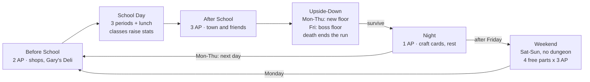

# Project Vector — Design & Development Doc

Oct 23, 2026 · @Sam

## 1. Overview

Project Vector (working title) is a top-down 2D pixel-art RPG where you live a high-school week by day and fight through a town-shaped dungeon by night, using spell cards you build from the Vector magic system. The alpha covers 5 in-game weeks, built in Godot 4, with roguelike permadeath.

**Pitch.** You are the new kid in town. By day you pick classes, raise stats, explore an open-ish town (the blacksmith, Gary's Deli, the hospital) and befriend or alienate classmates and townsfolk. Every evening you must enter the Upside-Down, a twisted mirror of the town that regenerates daily and ends in a boss every Friday. Spells are cards you designed earlier in the week by combining Vectors; you can also improvise combinations mid-fight at a higher cost and risk.

**Design pillars**

1. **Time is the currency.** Every day has limited actions per day part. Training, crafting cards, socializing and exploring all compete for the same slots.
2. **Prepare, then improvise.** Cards are rehearsed magic: cheap and stable. Improvised casts are flexible but cost more Focus and risk Instability.
3. **The town is the dungeon.** What happens in town shapes that week's Upside-Down: its Vector signature, enemies and boss.
4. **Choices have teeth.** Dialogue, relationships and early decisions can change the story, unlock classes, or get you killed (see Kelly).
5. **One system underneath.** Stats, magic, enemies, items, NPC dispositions and bonds all use the Vector system, so content is data, not code.

**Genre and references.** Life-sim calendar RPG (the Persona school-plus-dungeon structure), tactical grid card combat with movement (in the spirit of South Park: The Fractured but Whole's grid fights, with a Slay the Spire-style hand), roguelike runs, and a DnD-style branching story voiced by a narrator who is also a character.

**Platform and look.** PC (Windows, macOS, Linux) first. Top-down pixel art, 16x16 tiles at a 480x270 base resolution scaled to 1080p and up.

## 2. Core loop and calendar

Each school day has 8 day parts; each part gives a small budget of Action Points (AP), and once they are spent (or you choose to move on) time advances. Evening is always the dungeon on weekdays.



Monday to Thursday nights loop straight to the next morning; Friday night leads into the free weekend, and dying in the Upside-Down ends the run.

### The action mechanic

Inspired by the limited-action days of Kindergarten, but with more texture:

- **Walking is free.** Moving around the map, reading signs and examining objects costs nothing.
- **Meaningful interactions cost AP.** Talking to an NPC past the greeting, buying from a shop, training, crafting a card, using a location's activity.
- **Some actions take the whole part.** Attending a class consumes its period entirely.
- **Leftover AP is lost** when the part ends. The player can end a part early from the pause menu or by going somewhere that triggers it (for example walking into class).
- **Hidden actions.** Some interactions only appear if a condition is met (a stat Gate, a bond tier, a flag from an earlier event). The narrator may hint at them.
- **Some events are free and forced.** Story scenes fire on entering a part or a location and cost no AP.

### Day parts (weekdays)

| # | Day part | Where | AP | Notes |
| --- | --- | --- | --- | --- |
| 1 | Before School | Home, town | 2 | Shops open early; Gary's Deli breakfast |
| 2 | Period 1 | School | Whole part | Attend a class or skip |
| 3 | Period 2 | School | Whole part | Attend a class or skip |
| 4 | Lunch | School grounds, cafeteria | 2 | Prime social time |
| 5 | Period 3 | School | Whole part | Attend a class or skip |
| 6 | After School | Town, clubs | 3 | Shops, training, hangouts, side quests |
| 7 | Evening | The Upside-Down | Dungeon | Mandatory Mon to Fri |
| 8 | Night | Home | 1 | Craft cards, rest, journal, phone texts |

Skipping a class frees the period as a 2 AP free part, at a cost: attendance drops, the teacher's opinion falls, and three skips in a week triggers a detention event.

### Week and run structure

- **Monday to Thursday:** a freshly generated dungeon each evening.
- **Friday:** the boss floor, with returning enemies from that week's runs.
- **Saturday and Sunday (proposed):** no school and no dungeon. Four free parts per day (Morning, Midday, Afternoon, Evening) at 3 AP each. Sunday night the narrator teases next week's Upside-Down signature.
- **A run** is the full 5-week alpha campaign. Dying anywhere ends the run (Section 14).

### Action costs (starting values, tune in playtests)

| Action | AP |
| --- | --- |
| Talk (one conversation topic) | 1 |
| Give a gift | 1 |
| Buy or sell at a shop | 1 per visit |
| Train a stat at a location | 2 |
| Craft a spell card at the workbench | 1 (Night only) or 2 elsewhere |
| Hang out with a party member | 2 |
| Location activity (deli shift, forge, hospital volunteering) | 2 |

## 3. Town, map and exploration

The town is a single walkable top-down map split into connected zones, open-world-ish: everything is reachable on foot, a few areas unlock through story. Which NPCs stand where depends on the day and day part.

### Map rules

- **Zones** are separate Godot scenes (school, downtown, residential, outskirts) joined by edge transitions and doors. Each zone is about 3 to 6 screens.
- **NPC schedules** place characters by day and day part (Kelly at the field after school on Tuesdays, Gary always at the deli until 8 pm).
- **Points of interest** show an icon when an interaction is available and how many AP it costs.
- **Locked areas** open by story flag or stat Gate (a rusted gate needs STR 8, a hidden alley needs PER 7).
- **Fast travel** is a bus stop network unlocked in week 2, and costs no AP.

### Locations

The full town plan is in `docs/TOWN.md`: four zones (school, downtown, residential with Maple Street, Elm Street and Hillside, and outskirts), a home on the map for every named character, and each place marked OPEN, EXTERIOR (visible, interior later), CLOSED (shut with a future hook, like the train station and the abandoned mansion) or STORY (opens on a story flag). The town name is a placeholder.

### What exploring gives you

- Items, materials and money.
- New NPCs and party candidates.
- **Signature hints**: clues about the coming week's Upside-Down Vector signature (a frozen pipe at the deli hints at Cold).
- Side quests and hidden actions.

## 4. School: classes and in-class events

You choose 3 classes each week, one per period; attending a class runs a short class event that raises that class's stats and nudges your Vector affinities toward its subject.

### Scheduling

- Every Monday morning (or Sunday night) you set your schedule for the week: one class in each of Periods 1, 2 and 3.
- The same class can be taken in more than one period for faster growth, with diminishing returns (each repeat that day gives half).
- Some classes are Gated: Advanced Chemistry needs Chemistry attended 5 times and INT 9.
- Attending builds **Grade** with that professor (a Bond-space axis per professor), which unlocks their mentorship, recommendation letters and class-advancement requirements.

### Class catalog (alpha)

| Class | Stat gains | Vector affinity nudge | Tie-ins |
| --- | --- | --- | --- |
| PE | STR, CON | Force | Cheer squad (Kelly), sports students |
| Physics | INT, DEX | Force, Motion | Precision crafting minigame |
| Chemistry | INT | Transmutation, Corrosion (Tier 3, locked until Knowledge Tier 3) | Hospital, potions |
| Earth Science | INT, PER | Heat, Cold | Signature hints about the dungeon |
| Shop Class | STR, DEX | Heat | Blacksmith apprenticeship |
| Drama | CHA | Light | Lowers misinterpretation chance |
| Debate | CHA, WIL | Binding | Unlocks persuasion topics |
| Biology | CON, INT | Vitality (Tier 3, locked) | Hospital volunteering |
| History | WIL, Magic Resistance | none (lore) | Town history, Upside-Down origin clues |

Stat gains per attendance: +1 to the primary stat's experience bar (a stat point every 3 to 5 bars, rising with the stat), +2 raw weight on the affinity axis before renormalizing. Numbers are starting values.

### In-class events

Each attendance draws one event from the class's event pool by weighted Sample. The pool mixes:

- **Lesson** (most common): a short scene, then the stat gain.
- **Pop quiz**: a quick stat check or a tiny minigame; success doubles the gain.
- **Partner work**: you are paired with a random classmate in that class; +Bond with them and a chance to unlock a conversation topic.
- **Disruption**: Kelly or another student causes a scene; your response changes Bonds and can be misinterpreted (Section 12).
- **Accident**: a lab or shop mishap; a DEX or WIL check, failure costs HP that carries into tonight's dungeon.
- **Professor spotlight**: high Grade triggers a one-on-one that can teach a Vector, a Form or a perk.
- **Story beat**: authored events on fixed days that advance the main plot.

Events are data (JSON) with conditions, weights and outcomes, so new ones are added without code.

## 5. Stats and character model

Every character (player, party member, NPC, enemy) uses the same model: seven core stats, derived combat values, a Vector affinity table and a trait list, all as vectors in their own spaces.

### Core stats (Stats space, 1 to 20 in the alpha, start 3 to 8)

| Stat | Governs |
| --- | --- |
| STR (Strength) | Physical damage, carry weight, some locked doors |
| DEX (Dexterity) | Movement range, initiative, dodge, crit chance |
| CON (Constitution) | Max HP, resistance to status effects |
| INT (Intelligence) | Max MP, card crafting quality, Knowledge Tier progress |
| PER (Perception) | Seeing hidden actions, scouting enemies, trap detection |
| WIL (Willpower) | Magic Resistance, Stability (Instability rolls), fear checks |
| CHA (Charisma) | Dialogue Gates, misinterpretation chance, shop prices, recruitment |

### Derived values

| Value | Formula (starting values) |
| --- | --- |
| Max HP | 20 + CON x 4 + class bonus |
| Max MP (Focus Points) | 10 + INT x 2 + WIL + class bonus |
| Movement | 3 + floor(DEX / 5) tiles per turn |
| Initiative | DEX + PER / 2, ties by fixed order |
| Physical Defense | CON / 2 + armor |
| Magic Resistance | WIL / 2 + gear; reduces incoming spell damage by a percent |
| Stability | WIL + INT / 2; the target for Instability rolls |
| Crit chance | 5% + DEX / 2 percent |

### Elemental affinity and resistance

- **Vector affinity** is the Magic Vectors affinity table (Heat, Cold, Force, Motion, Binding, Light, then Tier 3). It sets the odds of which Vector you learn on level-up and gives a small damage bonus on your strongest axes. It is shown as bars on the character sheet.
- **Known Vectors** is the set you can actually use in cards. Starting characters know 1 or 2.
- **Elemental resistance** is a signature over the same axes (weak 1.5, neutral 1.0, strong 0.6), shared with enemies.
- **Knowledge Tier** (1 to 3 in the alpha) caps which Vectors, Forms and Magnitudes are available.

### Traits

A trait is a small edit to one or more vectors (+2 CHA, +10% Heat affinity, -1 Movement, "misinterpretation chance x0.5"). Story NPCs have **fixed traits**; their remaining slots and all generic NPCs **roll traits** from weighted tables at run start, so the town differs each run.

### Character record (data)

```json
{
  "id": "player",
  "name": "New Kid",
  "class": "mage",
  "level": 1, "xp": 0,
  "stats": { "str": 4, "dex": 5, "con": 5, "int": 7, "per": 5, "wil": 6, "cha": 4 },
  "vectorAffinity": { "heat": 20, "cold": 20, "force": 15, "motion": 15, "binding": 15, "light": 15 },
  "knownVectors": ["heat"],
  "knownForms": ["bolt", "shield"],
  "knowledgeTier": 1,
  "resistances": {},
  "traits": ["night_owl"],
  "deck": ["card_ember_bolt", "card_ember_bolt", "card_guard"],
  "equipment": { "weapon": null, "armor": null, "trinket": null },
  "flags": {}
}
```

## 6. Classes, leveling and advancement

You pick one of 5 starting classes; your class sets stat growth per level, perks, starting deck and Vector or Form affinities, and at level markers 5 and 12 you can advance into a new class if you meet its requirements.

### Starting classes

| Class | Growth weights (stat point odds per level) | Starting kit | Signature perk |
| --- | --- | --- | --- |
| Mage | INT 35, WIL 25, PER 15, others 25 | 2 Vectors, Bolt + Shield, 8-card deck | **Overchannel**: once per fight, improvise at normal card cost |
| Fighter | STR 35, CON 30, DEX 15, others 20 | 1 Vector, Weapon Infusion, melee cards | **Second Wind**: heal 20% HP once per fight under 30% HP |
| Rogue | DEX 35, PER 25, CHA 10, others 30 | 1 Vector, Bolt, mobility cards | **Backstab**: +50% damage from behind or flank on the grid |
| Healer | WIL 30, CON 20, INT 20, others 30 | Light, Shield + Aura | **Triage**: healing cards cost 1 less MP on allies under half HP |
| Bard | CHA 35, WIL 20, DEX 15, others 30 | 1 Vector, Burst, buff cards | **Hype**: party members gain initiative and +1 draw on turn 1 |

### Level-up

Each level, using the Vector operations:

1. **Stat points**: Sample 3 points from the class growth weights (with a small nudge from traits).
2. **HP and MP**: Shift by class bonus plus the derived formulas.
3. **Learning roll**: Sample from the Vector affinity table and Form affinity table; with pity, so after 3 rolls with nothing new only unknown axes stay in the table.
4. **Perks**: authored perks at class levels 3, 6 and 9 (pick 1 of 2).

XP comes mostly from the dungeon, with smaller amounts from story events and class spotlights. Target pace: about level 12 to 14 by the end of week 5.

### Advancement

At level 5 (Tier 2 classes) and level 12 (Tier 3 classes), a Class Change event offers every class whose Gate you meet. Taking one swaps growth weights and perk tree; you keep one perk from the old class. Requirements combine three kinds of Gates: previous class, stats, and story flags from your actions.

| Advanced class | Tier | Requirements | Identity |
| --- | --- | --- | --- |
| Elementalist | 2 | Mage; INT 9; know Heat and Cold | Two-Vector hybrid cards, bigger AoE Forms |
| Kinetic Logician | 2 | Mage; know Force or Motion; Physics attended 8 times | Knockback and push combos on the grid |
| Spellblade | 2 | Fighter or Rogue; INT 7; know Weapon Infusion | Infuses melee cards with Vectors |
| Guardian | 2 | Fighter; CON 10 | Taunt, zone control, ally shielding |
| Trickster | 2 | Rogue; CHA 8 | Card theft, status effects, teleport |
| Medic | 2 | Healer; 5 hospital volunteer shifts | Strong single-target healing, revive |
| Idol | 2 | Bard; CHA 11; befriended the cheer squad | Party-wide buffs, crowd control by charm |
| Deli Knight (hidden) | 2 | Any class; 10 shifts at Gary's Deli; Gary bond tier 3 | Food items in combat, Heat-and-Force tank |
| Smith-Mage (hidden) | 2 | Any; Shop Class 8 times; blacksmith apprentice flag | Builds constructs and gear mid-fight |
| Upside-Touched (hidden) | 3 | Survive 5 Wild Surges; WIL 12 | Unstable, very strong improvised casts |

Tier 3 classes beyond Upside-Touched are out of alpha scope but the data format supports them.

## 7. Vector system adaptation

The Vector system from the Nexus project carries over unchanged as the engine (vectors as weighted axes, the 8 pure operations, seeded RNG, data in JSON); this game changes which spaces exist and swaps the abstract Combat Power win formula for real grid combat. Put the original Vector System doc in the repo as `docs/vector_system.md` as the reference.

### Spaces used in this game

| Space | Axes | Used for | Change from Nexus |
| --- | --- | --- | --- |
| Magic Vectors | Tier 1: Heat, Cold, Force, Motion. Tier 2: Binding, Light. Tier 3: Transmutation, Vitality, Corrosion | Cards, affinities, resistances, dungeon signature | Same |
| Forms | Bolt, Burst, Shield, Weapon Infusion, Line, Sphere, Projectile, Touch, Aura, Construct, Glyph | Card shape on the grid | Each Form now has a grid footprint (Section 9) |
| Stats | STR, DEX, CON, INT, PER, WIL, CHA | Characters | Adds CHA; range 1 to 20 |
| Class growth | One axis per stat | Level-up Sample | Same idea as class priority |
| Bond | One signed axis per pair, -100 to +100 | Friendships, party synergy, Kelly | Same; Decay toward 0 weekly |
| Grade | One axis per professor, 0 to 100 | School standing | New |
| NPC disposition | Courage, Greed, Curiosity, Loyalty, Kindness, Pride | NPC choices, dialogue reactions | Promoted from proposed to built; adds Kindness and Pride |
| Dungeon signature | Magic Vector axes | Which enemies and resources spawn, weekly boss | Was realm flavor; now changes weekly |
| Material attributes | Hardness, Weight, Conductivity, Magic Affinity, Corrosion Resistance | Blacksmith gear | Same |

Dropped for this game: faction Standing and the P(win) = SP / (SP + ETR) formula.

### Where each operation is used

| Operation | Used for |
| --- | --- |
| Normalize | Affinity tables into odds; cards and signatures into directions |
| Sample | Level-up stats, learning Vectors and Forms, class events, dungeon rooms, enemy picks, rolled NPC traits, misinterpretation |
| Match | Dungeon signature vs enemy and loot tables; NPC disposition vs dialogue topic tone; card vs crafted property |
| Blend | Class and specialization tables, traits, mentorship, two-Vector hybrid cards |
| Shift | Stat training, class attendance, Bonds, disposition changes |
| Contest | Damage multiplier: card Vectors vs target resistance signature |
| Gate | Knowledge Tier caps, class requirements, Charisma dialogue topics, hidden actions, Bond tiers |
| Decay | Bonds drift weekly, disposition returns to resting personality, temporary buffs |

### Bond tiers (Gate lines)

| Bond | Tier | Effect |
| --- | --- | --- |
| -100 to -51 | Enemy | Sabotages you; Kelly betrayal risk |
| -50 to -11 | Rival | Snide dialogue, blocks some topics |
| -10 to 10 | Stranger | Default |
| 11 to 40 | Acquaintance | Can be invited to hang out |
| 41 to 70 | Friend | Can be recruited to the party |
| 71 to 85 | Close | Combo cards unlock |
| 86 to 100 | Unbreakable | No decay; a personal story arc and a unique card |

## 8. Spell cards, deckbuilding and improvised casting

A card is a spell you designed in advance (Vectors + Form + Magnitude) and saved into your deck; in battle you play cards cheaply and safely, or improvise a spell on the spot for 1.5x the MP, a discarded card and a real Instability risk.

### Anatomy of a card

| Part | Choices | Effect |
| --- | --- | --- |
| Vector | 1 known Vector, or 2 for a hybrid (Blend) | Damage type, Contest against resistances, side effect (Heat burns, Cold slows, Force pushes, Motion moves, Binding roots, Light reveals and heals) |
| Form | Any known Form | Grid shape, range and targeting (Section 9) |
| Magnitude | Minor 5, Standard 10, Major 20, Grand 35 | Base power; capped by Knowledge Tier (Tier 1: Standard, Tier 2: Major, Tier 3: Grand) |
| Property (optional) | Rolled at crafting | A bonus such as Searing Edge or Keen Balance from the Property Bank |

Non-magic cards (weapon strikes, Guard, Dash, consumable items) come from class kits, the blacksmith and loot, and use the same card format with no Vector.

### MP cost (starting values)

Cost = Magnitude cost + Form cost + 1 if hybrid.

| Magnitude | Cost |
| --- | --- |
| Minor | 1 |
| Standard | 2 |
| Major | 4 |
| Grand | 7 |

| Form | Cost |
| --- | --- |
| Bolt, Touch, Weapon Infusion | 0 |
| Projectile, Shield, Line | 1 |
| Burst, Sphere, Aura | 2 |
| Construct, Glyph | 3 |

### Crafting cards

Crafting happens at a workbench (home at Night for 1 AP, the library or blacksmith for 2 AP).

1. Choose Vectors, Form and Magnitude from what you know and your Tier allows.
2. Play the short crafting minigame chosen by the dominant Vector (Thermal for Heat or Cold, Precision for Force or Motion, Alignment for Binding or Light, Chemical for Tier 3). This reuses the Nexus invention pipeline.
3. Performance (0 to 1) rolls 0 to 2 Properties from the Property Bank by Match against the card's Vector direction, and can add +1 Magnitude step on a perfect score.
4. The card is added to your card library. You choose which library cards go into your active deck.

Extra copies of an existing design cost 1 AP each and skip the minigame (they keep the original's Properties).

### Deck rules

- Deck size: 10 to 20 cards (max grows +2 at levels 5 and 12). No more than 3 copies of a design.
- Each party member has their own deck; you edit any member's deck at a workbench.
- Opening hand 5; draw 2 at the start of each of that character's turns; hand limit 7.
- When a deck runs out, shuffle the discard pile back in and that character takes Fatigue (1 damage, rising by 1 each reshuffle).

### MP across the night

MP does not refill between fights in one night. It regenerates 2 + WIL / 5 per turn in combat, fully at a rest room, and partly from food (Gary's Deli). This makes every expensive cast a dungeon-wide decision.

### Improvised casting

On your turn, open the Vector Wheel and assemble any legal spell from your known Vectors and Forms.

- **Cost:** ceiling(card cost x 1.5) + 1 MP, plus discard 1 card from hand as fuel.
- **Instability roll:** d20 + Stability / 2 against 10 + 10 x (cost / current MP), +3 for improvised casts. Prepared cards roll only when they spend more than half your current MP.
- **Failure table (Sample):** Fizzle (MP spent, no effect), Backlash (half damage to yourself), Misfire (hits a random tile in range), Wild Surge (a random Vector from the whole space, which can help or hurt).
- **Mastery:** the usage vector of improvised and played pairs drives Breakthroughs: the most-used Vector and Form pair gains +1 Magnitude step at level markers.

### Card data

```json
{
  "id": "card_ember_bolt",
  "name": "Ember Bolt",
  "vectors": { "heat": 1.0 },
  "form": "bolt",
  "magnitude": "standard",
  "properties": ["searing_edge"],
  "cost": 2,
  "owner": "player",
  "craftedOn": { "week": 1, "day": "mon" }
}
```

Damage = Magnitude x Form multiplier x (1 + caster affinity bonus) x Contest multiplier x (1 - target Magic Resistance %). Physical cards use STR or DEX instead of Magnitude and Physical Defense instead of Magic Resistance.

## 9. Tactical grid combat

Fights happen on a small tactical grid with movement and positioning, in the spirit of The Fractured but Whole, while each character's hand of cards sits at the bottom of the screen; Forms become shapes on the grid and Vectors add positional effects like push, slow and root.

### Battlefield and camera (2.5D)

Combat is shown in a 2.5D side view like South Park: The Fractured but Whole: the camera looks at the battlefield from the front and above (about 30 degrees down), the grid recedes into the screen, the party stands on the left and enemies on the right, and characters are upright 2D sprites standing on the grid.

- **Logic stays a flat grid.** `src/core/combat/grid.gd` knows nothing about the camera. Only the combat scene projects grid cells to the screen.
- **Projection:** a `GridProjection` helper in the combat scene maps (col, row) to screen space. Rows further back are drawn higher up the screen and slightly narrower (mild perspective, about 8 to 12% narrower per row back), so the grid reads as a floor seen at an angle. Cells are drawn as trapezoids with soft outlines; the hovered cell, movement range and spell footprints are tinted overlays on those trapezoids.
- **Sprites stay crisp:** characters and props are never scaled by non-integer amounts. Depth comes from position, draw order (y-sort by row, back rows first) and a small oval shadow under each unit, not from scaling pixel art. Back rows may be drawn slightly darker for depth.
- **Size:** 9 columns by 5 rows by default (wide and shallow, like the reference), configurable per room in data from 8x4 to 10x6.
- **Backdrop:** each fight uses a painted backdrop from the room's theme behind the grid (placeholder: a tinted Ninja Adventure tileset strip or flat gradient), so the Upside-Down version of the deli or school reads at a glance.
- **Facing:** units face left or right only (party faces right, enemies face left; they flip when they move past a target). Flanking means attacking from behind relative to that facing, or from a different row than the target is facing.
- Party of up to 4 (you plus 3), facing 2 to 8 enemies.
- Terrain: floor, wall (blocks movement and line of sight), half cover (-25% ranged damage), hazard (damage on entry), water, and props that can be pushed or broken. Tall props and walls are drawn as upright sprites on their cell, sorted like units.
- Camera: fixed framing that fits the whole grid; a small zoom-in punch and screen shake on big hits. No free camera rotation.

### Turn structure

1. **Initiative timeline** across the top orders every unit individually (DEX + PER / 2), so allies and enemies interleave.
2. On a character's turn: **draw 2**, regain MP, then in any order:
    - **Move** up to Movement tiles (you can split movement before and after cards).
    - **Play cards** while MP lasts.
    - **One free basic action**: Strike (weapon, adjacent) or Guard (+defense until next turn).
    - **Improvise** with the Vector Wheel (Section 8).
3. **End turn** discards nothing; unplayed cards stay in hand up to the limit of 7.

### Forms on the grid

| Form | Footprint | Range | Damage multiplier |
| --- | --- | --- | --- |
| Touch | 1 adjacent tile | 1 | 1.5 |
| Bolt | 1 tile, needs line of sight | 5 | 1.0 |
| Projectile | First unit along a straight line | 7 | 1.0 |
| Line | Every tile in a straight line | 4 long | 0.8 |
| Burst | 3x3 square on a target tile | 4 | 0.7 |
| Sphere | Diamond radius 2 around the caster | self | 0.7 |
| Shield | One ally absorbs damage equal to Magnitude for 2 turns | 3 | n/a |
| Aura | Zone radius 1 around caster, ticks each turn for 3 turns | self | 0.4 per tick |
| Weapon Infusion | Your next 2 Strikes gain the Vector | self | weapon x Vector |
| Construct | Places an object (wall, turret, decoy) for 3 turns | 3 | varies |
| Glyph | Trap on a tile, fires when entered | 4 | 1.2 |

### Vector effects on the grid

| Vector | Positional effect |
| --- | --- |
| Heat | Burning tiles for 2 turns; turns water to steam that blocks sight |
| Cold | Slow (-1 Movement); freezes water into walkable ice |
| Force | Push 1 tile per 10 Magnitude; collision with walls or units deals bonus damage |
| Motion | Teleport, swap places, pull, or extra movement for allies |
| Binding | Root (no movement) for 1 turn; tethers two units |
| Light | Reveals hidden enemies and traps, blinds (-accuracy), heals with Shield or Aura |
| Transmutation, Vitality, Corrosion (Tier 3) | Change terrain; heal or drain; shred armor |

### Enemy AI

Each enemy has a disposition vector (Courage, Greed, Pride and so on) and each possible action carries a profile vector. The AI scores reachable actions by expected value x Match(disposition, profile) and picks with Sample, so a cowardly goblin retreats and a proud boss duels the strongest party member, without per-enemy scripts. Bosses add authored phase scripts on top.

### Winning, losing, fleeing

- Win by defeating all enemies (or the boss's objective).
- Flee from any non-boss fight by moving every party member to an exit tile; it costs the room's loot.
- A party member at 0 HP is **downed** for the fight and can be revived; if still down at the end, they are **injured** and spend tomorrow at the hospital (unavailable for the next dungeon).
- **If you (the player) reach 0 HP, the run ends** (Section 14).

### Combat UI

Hand of cards along the bottom, initiative timeline along the top, unit panel on the left, tile highlights for range and area, a Vector Wheel button beside the hand, MP and HP bars, and an end-turn button. Hovering a card previews its footprint, damage after Contest and Instability odds.

## 10. The Upside-Down

Every weekday evening you enter the Upside-Down, a twisted mirror of the town; Monday to Thursday it is a newly generated floor, and Friday is the boss floor where enemies from earlier in the week return before the boss. Each week has a Vector signature built from the town, which decides its enemies, loot and boss.

### Weekly signature

- Each week starts from an authored base signature (Week 2 leans Cold and Force, for example).
- Town events and your choices Shift it during the week: letting the deli freezer fail adds Cold; helping the blacksmith keep the forge lit adds Heat.
- Enemies, loot and room themes are weighted by Match(signature, their signature).
- The signature is never shown outright. Players infer it from **signature hints** in town and from Earth Science class.

### Daily floor generation

| Day | Rooms | Contents |
| --- | --- | --- |
| Monday | 6 | Mostly normal fights, 1 rest room |
| Tuesday | 7 | Adds an elite room |
| Wednesday | 8 | Adds an event room and a treasure room |
| Thursday | 9 | 2 elites, a merchant |
| Friday | Boss floor | 3 returning encounters, 1 rest room, the boss |

- Generation: a seeded random walk lays rooms on a grid (seed = run seed + week + day); each room is a hand-built chunk from the week's theme set (twisted classrooms, a frozen deli, a burning forge).
- Room types: combat, elite, treasure, rest, event (narrator scenes, choices), merchant, exit.
- You explore in top-down view; touching an enemy group or entering a combat room starts a grid fight on that room's layout.
- The night ends when you reach the exit room. You can leave as soon as you find it, trading loot and XP for safety.

### Friday: the boss floor

- The game logs every encounter from Monday to Thursday.
- Friday pulls 3 of them back, scaled up. **Enemies you fled from come back first**, stronger ("unfinished business").
- Then the boss, with 2 to 3 authored phases.
- Beating the boss clears the week, gives a large reward (a new Vector or Form, a rare material, a story beat) and changes the town for the next week.

### Alpha bosses (proposed, one per week)

| Week | Boss | Town source | Signature |
| --- | --- | --- | --- |
| 1 | The Hollow Mascot | The school's pep rally and cheer squad | Force, Light |
| 2 | The Cold Cut | Gary's Deli freezer | Cold, Force |
| 3 | The Forge Revenant | The blacksmith's forge | Heat, Binding |
| 4 | The Night Ward | The hospital's closed wing | Binding, Vitality |
| 5 | The Mirror Town | The whole town, and the narrator | All Tier 1 and 2 |

### Rewards

XP, money, crafting materials, **Vector shards** (progress toward learning a Vector), Research Points for card crafting, occasional finished cards, and story items.

## 11. Party, bonds and recruitment

You recruit party members from the people you meet at school and in town once your Bond with them reaches Friend (41+); you take up to 3 into the Upside-Down each night, and Bonds between all party members change how well they fight together.

### Recruitment

- **Who can join:** any story character marked recruitable, plus some randomized students. Professors, Gary and the blacksmith are not party members in the alpha but act as mentors and suppliers.
- **How:** reach Friend Bond, then a recruitment event (an ask, a favor or a quest). Some need extra Gates (a CHA check, a story flag, beating a boss).
- **Roster:** recruited characters wait in a roster; you choose 3 for each night at the Upside-Down entrance.
- **Availability:** injured members are at the hospital for a day; some have schedule conflicts (a cheer competition on Thursday).
- **Leaving:** Bond dropping below Acquaintance or a betrayal event can remove a member.

### Party member model

Same character record as the player (Section 5) plus:

- Their own class, deck and level. They gain XP only when they join a run, with a catch-up bonus for those who sat out.
- A **disposition vector** that colors their behavior and how they react to your choices.
- **Fixed traits** for story characters, rolled traits for random students.
- A **personal arc** unlocked at Bond tier Close, with a unique card at Unbreakable.

### Bonds in combat

- Pairs at Close or above unlock **combo cards**: two members spend a turn together for a joint spell (a Heat + Force member pair makes a "Furnace Ram").
- Adjacent allies with Friend Bond or better get +5% damage.
- Negative Bonds have teeth: Rivals may ignore your buffs or block your line; Enemies can betray you (Kelly, Section 13).

### Changing Bonds

| Source | Typical change |
| --- | --- |
| A good conversation topic | +3 to +8 |
| A misinterpreted line | -2 to -10 |
| Hanging out (2 AP) | +6 to +12 |
| A liked or disliked gift | +5 to +15, or -5 |
| Fighting together | +2 per fight survived |
| Saving them in combat | +8 |
| Story choices | -30 to +30 |
| Weekly Decay (below Unbreakable) | 5% toward 0 |

## 12. Social system: dialogue, Charisma and misinterpretation

Conversations are built from topics; each topic may be locked behind a Charisma Gate, lands well or badly depending on how it Matches the listener's disposition, and has a chance to be misinterpreted that falls as your Charisma rises.

### Topics

- Each NPC has a topic list: small talk, personal topics, rumors you have heard, items you carry, story topics.
- A topic costs 1 AP and has a **tone profile** over the disposition axes (a joke is high Curiosity; a compliment targets Pride; a dare targets Courage).
- **Reception** = Match(NPC disposition, tone profile), adjusted by today's mood and current Bond. It sets the Bond change from -10 to +10.
- **Gates:** some topics need CHA ("Ask Kelly about her dad" needs CHA 10), a Bond tier, an item, or a flag. Locked topics appear greyed with a hint so players know what to aim for.
- **Rumors** are topics learned elsewhere (overheard at lunch, Gary's gossip) that open new options with other people.

### Misinterpretation

Every spoken line has a base risk: safe small talk 5%, jokes 20%, bold or personal lines 30%.

Chance = base risk x (1 - CHA / 25) x mood modifier (bad mood x1.5), minimum 2%.

When it triggers, the game Samples a misheard version of the line from that line's alternates (authored per line, with generic fallbacks). The screen shows what you meant, then what they heard, and the narrator usually has something to say. Reception is then computed from the misheard version's tone instead. High-risk lines also have higher upside, so Charisma builds open up bolder, better conversations.

### Dialogue example (data)

```json
{
  "id": "kelly_topic_cheer",
  "npc": "kelly",
  "label": "Compliment her routine",
  "apCost": 1,
  "gate": { "cha": 6 },
  "tone": { "pride": 0.8, "kindness": 0.2 },
  "baseRisk": 0.2,
  "line": "That routine was actually really impressive.",
  "misheard": ["That routine was actually... impressive?", "Is the routine always that long?"],
  "outcomes": { "onGood": { "bond": 6 }, "onBad": { "bond": -4, "flag": "kelly_annoyed" } }
}
```

### NPC disposition axes

| Axis | Range | High means |
| --- | --- | --- |
| Courage | -100 to 100 | Takes risks, respects bold moves |
| Greed | -100 to 100 | Swayed by gifts and money; raises prices |
| Curiosity | -100 to 100 | Enjoys jokes, rumors and odd questions |
| Loyalty | -100 to 100 | Bonds decay slowly; hates betrayal |
| Kindness | -100 to 100 | Responds to sincerity; dislikes cruelty |
| Pride | -100 to 100 | Loves compliments; punishes slights |

Disposition Shifts with events and Decays back toward each NPC's resting personality.

## 13. Story, narrator and cast

You are the new kid in a small town where, every evening, people with the Vector spark are pulled into the Upside-Down; the story runs across 5 weeks with branching choices, told by a narrator who is also a character with opinions about you. Names marked (proposed) are placeholders.

### Story skeleton (alpha, proposed)

| Week | Act beat | Key choice |
| --- | --- | --- |
| 1 | Arrival. First day at school, meet Kelly, Gary and the narrator. That evening the Upside-Down opens and you and Kelly are pulled in. | How you treat Kelly decides whether you survive the first night |
| 2 | Others are being pulled in too. You start forming a party. Mr. B starts paying attention to you. | Who you recruit first |
| 3 | The town notices: disappearances, the forge goes cold. | Go along with Mr. B's cover-up or expose it |
| 4 | The hospital's closed wing hides the Upside-Down's history. | Who you trust with what you learn |
| 5 | The Mirror Town. The narrator's role is revealed. | Alpha ending, branching on Bonds and choices |

**Why you go in every night (proposed):** at dusk the spark pulls you in wherever you stand. Choosing to walk in through the woods edge lets you pick your party and starting room; getting pulled in elsewhere drops you somewhere random.

### The narrator

- Speaks over scenes in a storybook voice, comments on choices, reacts to misinterpretations, and sometimes hints at hidden actions.
- Is a real character: appears physically at the woods edge and in event rooms, can be talked to, and has a Bond with you that changes how helpful (or sarcastic) the hints are.
- Is also a fixed-trait NPC: high Curiosity, Pride and an unknown Loyalty.
- Their true identity is the week 5 reveal (open question).

### Kelly and the first-night betrayal

Kelly is the popular cheerleader, rude to the new kid. Fixed traits: Pride 70, Kindness -30 (resting), Courage 20, Loyalty 60 once earned (hidden).

On Monday of week 1 she is pulled into the Upside-Down with you as a temporary guest ally in the tutorial floor. The game tracks a hidden **Kelly Risk** score from your actions that day:

| Action (week 1, Monday) | Risk |
| --- | --- |
| Mock or insult her at lunch (including a misinterpreted line) | +2 |
| Side with the students laughing at her in a class Disruption event | +1 |
| Ignore her call for help in the first tutorial fight | +2 |
| Take the shortcut she begs you not to take | +1 |
| Refuse to let her carry the lantern | +1 |
| Defend her from another student | -2 |
| Shield or heal her in combat | -2 |
| Kind or Charisma-gated reassurance when she panics | -1 |

At the floor's scripted panic moment, if Kelly Risk is 4 or more, she panics and accidentally triggers a collapse that kills you. The narrator delivers the ending and the run restarts from character creation. Fairness rule: every risk action is visible in hindsight, and the narrator foreshadows the panic moment twice before it happens. If you survive, Kelly's Bond starts from her Risk result and her arc continues; she is recruitable later but at a high Bond requirement.

### Cast

The full cast is in `docs/characters.md` (character dossiers, Revision 3): stats, class, Vectors, resting disposition, fixed traits, schedules, dialogue topics, gifts, story hooks and Upside-Down versions. It replaces the placeholder names that used to be here. Key changes from the placeholders:

- **Mr. B, the vice principal, is the main villain.** He has quietly fed inconvenient people to the Upside-Down for years and has leverage over the Mayor. He's in the background from week 1, escalates through weeks 2 to 4, and is revealed in week 5. Week 3's "cover-up" choice is about his cover-up.
- **Teachers:** Coach Byrne (PE, cheer adviser), Ms. G (Physics and Chemistry), Mr. Mustard (Drama and Debate, Idol mentor), Mr. J (Shop Class), Ms. Nonsense (History, reluctant lorekeeper), plus an Earth Science Teacher and a Biology Teacher (names TBD).
- **Town:** Gary, the Blacksmith (name TBD), Dr. Reyes, Nurse Patti, Ms. Marlowe (librarian), the Mayor, and the player's Parent/Guardian.
- **Recruitable (14):** Kelly; the Core Four (Theo, Dex, Priya, Mara); and the side students (Sam, Baxter, Jon, Kris, Diane, Penny, Jake, Phase, Mel).
- **Flavor NPCs:** Kara and Kayla (cheer squad), the Innocent Bystander, and Todd (who goes missing for a day at a time and is never explained).
- **Hidden:** Sam, Unmasked (hidden class Complete Axiomatic Mage). The concept and gate are locked (requires a party member in a Tier 3 class); everything else is TBD and out of alpha scope.

## 14. Death, saves and roguelike structure

Any player death ends the run and sends you back to character creation; saves exist only to suspend and resume a run, never to undo a mistake.

### Rules

- **Player death** (0 HP in any fight, the Kelly betrayal, or a lethal story choice) ends the run. The narrator gives an ending scene specific to the cause.
- **Party members** can be downed and injured but do not die permanently in the alpha (open question: should they?).
- **One save slot per run.** The game autosaves at every day-part change and on quit. Loading resumes; there is no manual save or reload.
- **Run seed:** each run gets a random seed (shown on the death screen, enterable for testing) that drives rolled NPC traits, class events and dungeon floors. Fixed story characters and authored events stay the same.
- **Crash safety:** the autosave is written atomically (write to a temp file, then rename) so a crash never corrupts the run.

### Between runs (proposed light meta-progression)

The narrator remembers. A persistent **Narrator's Journal** keeps lore you uncovered, enemy entries and endings seen. It can also unlock small starting options (a new background or trait to choose at creation) but never raw power, so each run stays a fresh challenge.

## 15. Alpha scope (5 weeks)

The alpha is one complete 5-week run, playable start to an ending, with every system in this doc working at small content counts; content can then grow without new code.

### Content targets

| Content | Alpha count |
| --- | --- |
| In-game weeks | 5 (35 days) |
| Bosses | 5 |
| Starting classes | 5 |
| Advanced classes | 10 (7 Tier 2 standard, 2 hidden Tier 2, 1 hidden Tier 3) |
| School classes | 9 |
| Town zones | 4 (school, downtown, residential, outskirts) |
| Named story NPCs | about 35 (see docs/characters.md) |
| Recruitable party members | 14 in data; Kelly and the Core Four fully authored, side students with lighter arcs |
| Normal enemy types | 15 to 20 |
| Elite enemy types | 5 |
| Vectors | 6 Tier 1 and 2, plus 3 Tier 3 locked behind Knowledge Tier 3 |
| Forms | 11 |
| Class events | about 8 per class (about 70) |
| Town and story events | about 60 |
| Dungeon room chunks | about 10 per week theme |
| Crafting minigames | 4 archetypes, simple versions |

### In scope

All systems in Sections 2 to 14, controller and keyboard input, placeholder pixel art where final art is missing, a text-only narrator (no voice), English only, PC builds.

### Out of scope for the alpha

Voice acting, localization, console or mobile builds, Tier 3 classes beyond Upside-Touched, permanent party member death, multiple save slots per run, and an online leaderboard.

## 16. Technical architecture (Godot 4)

Build in the latest stable Godot 4.x with statically typed GDScript; keep all game rules in plain, testable script classes that never touch nodes, keep all content in JSON under `data/`, and let scenes only display state and forward input.

### Engine settings

- Base resolution 480x270, stretch mode `viewport`, integer scaling, nearest-neighbor filtering, 16x16 tiles.
- `TileMapLayer` nodes for town zones and dungeon rooms; `AStarGrid2D` for grid movement and enemy pathing.
- Input map for keyboard and controller from day one.

### Core principles

1. **Rules apart from rendering.** `VectorOps`, combat resolution, calendar, dialogue checks and generation are pure classes that run headless in tests.
2. **Data, not code.** Classes, cards, enemies, events, topics, rooms and bosses are JSON records loaded by `DataDB` and checked by a schema validator at startup.
3. **Seeded randomness, split into streams.** One run seed; separate RNG streams for dungeon, combat, events, dialogue and NPC rolls, so a change in one system does not shift another's results.
4. **One source of truth.** `GameState` holds the whole run; saving is serializing it to JSON.
5. **Signals for coupling.** An `EventBus` autoload carries events like `day_part_changed`, `bond_changed`, `card_played`.

### Autoloads (singletons)

| Autoload | Responsibility |
| --- | --- |
| `DataDB` | Loads and validates every JSON file in `data/`; lookups by id |
| `GameState` | Run seed, player, roster, flags, Bonds, town signature, encounter log |
| `Calendar` | Week, day, day part, AP; advances time and fires scheduled events |
| `Rng` | Named seeded streams (`Rng.stream("dungeon")`) |
| `EventBus` | Global signals |
| `SaveSystem` | Atomic autosave and load of `GameState` |
| `Narrator` | Queues narrator lines from events and reactions |
| `SceneRouter` | Transitions between town zones, dungeon, combat and menus |

### Project layout

```
project-vector/
  project.godot
  CLAUDE.md
  docs/
    DESIGN.md              # this document
    vector_system.md       # the original Vector System doc
  data/
    spaces.json            # vector spaces and axes
    matchups.json
    stats.json             # derived stat formulas and constants
    classes.json
    perks.json
    traits.json
    forms.json
    vectors.json
    properties.json        # Property Bank
    cards/                 # starter and loot cards
    enemies/
    bosses/
    npcs/                  # story NPCs: fixed traits, schedules, topics
    topics/
    events/                # class, town, story and dungeon events
    school_classes.json
    locations.json
    weeks.json             # base signatures, bosses, story beats per week
    rooms/                 # dungeon room chunks per theme
  src/
    core/                  # pure logic, no nodes
      vector_ops.gd
      rng_streams.gd
      calendar_logic.gd
      character.gd
      card.gd
      deck.gd
      combat/
        combat_state.gd
        grid.gd
        forms.gd
        resolver.gd        # damage, Contest, effects, Instability
        enemy_ai.gd
      dungeon/
        floor_generator.gd
        signature.gd
      social/
        dialogue_check.gd  # Gates, reception, misinterpretation
        bonds.gd
      progression/
        leveling.gd
        class_change.gd
        crafting.gd
    autoload/
    scenes/
      town/
      dungeon/
      combat/
      ui/
      minigames/
  assets/
    sprites/  tiles/  ui/  audio/  fonts/
  tests/                   # GUT unit tests for src/core
```

### Key interfaces (sketch)

```gdscript
class_name VectorOps
static func normalize_sum(v: Dictionary) -> Dictionary
static func normalize_len(v: Dictionary) -> Dictionary
static func sample(p: Dictionary, rng: RandomNumberGenerator, axis_order: Array) -> String
static func similarity(a: Dictionary, b: Dictionary) -> float  # "Match"; `match` is a GDScript keyword
static func blend(vs: Array, weights: Array) -> Dictionary
static func shift(v: Dictionary, delta: Dictionary, caps: Dictionary) -> Dictionary
static func contest(attack: Dictionary, defense: Dictionary, table: Dictionary) -> float
static func gate(v: Dictionary, thresholds: Dictionary) -> bool
static func decay(v: Dictionary, rate: float, rest: Dictionary) -> Dictionary
```

Vectors are `Dictionary` of axis name to float, stored raw; zero-vectors and ties follow the rules in the Vector System doc (ties broken by fixed axis order).

### Tooling

- **Tests:** a built-in headless runner (`tests/run_tests.gd`) covers `src/core`; GUT can be added later if wanted.
- **Dialogue and cutscenes:** topic conversations use the custom JSON system in Section 12; longer authored scenes can use the Dialogue Manager addon if writing in a script format is easier.
- **Debug menu:** jump to any week, day and part; set stats, Bonds and flags; spawn any fight; show the town signature and RNG seeds.
- **Version control:** Git with Git LFS for art and audio.

## 17. Build order for Claude Code

Build in 9 milestones, logic before art: the Vector core and combat rules first (tested headless), then a playable grid fight, then the calendar and town, then the dungeon, and only then content and polish. Each milestone ends with something playable or tested.

1. **M0 — Project skeleton.** Godot project, folder layout, autoloads stubbed, pixel settings, input map, headless test runner, `DataDB` loading and validating JSON, debug menu shell. *Done when:* the project runs and a test suite passes.
2. **M1 — Vector core.** `VectorOps` with all 8 operations, seeded RNG streams, the zero-vector, tie and cap rules. *Done when:* unit tests reproduce the three worked examples from the Vector System doc exactly.
3. **M2 — Characters, cards, decks.** Character record, derived stats, card model, MP cost, deck draw/discard/reshuffle with Fatigue, leveling with Sample and pity. *Done when:* a test builds a mage, levels to 5 with a fixed seed and gets the same result every time.
4. **M3 — Grid combat (vertical slice).** Combat grid from a hand-built room, initiative timeline, movement with `AStarGrid2D`, hand UI, all 11 Form footprints, Vector grid effects, Contest damage, Instability and the Vector Wheel, 3 enemy types with disposition AI, win and lose. *Done when:* a full fight with a 2-person party is playable with placeholder art.
5. **M4 — Calendar and AP.** Day parts, AP, schedule selection, class attendance with class events, Night crafting at a workbench (minigames can be stubs that return a Performance slider). *Done when:* you can play a week of days with no dungeon and see stats change.
6. **M5 — Town.** Four zones with transitions, NPC schedules, points of interest with AP costs, shops, Gary's Deli, blacksmith, hospital. *Done when:* you can walk the town, buy, train and meet NPCs on schedule.
7. **M6 — Social system.** Topics, Charisma Gates, reception by Match, misinterpretation with misheard lines, Bonds and tiers, recruitment, narrator lines. *Done when:* the Kelly Monday scenario can be scripted and her Risk score tracked.
8. **M7 — The Upside-Down.** Weekly signature, floor generator, room types, encounter log, Friday boss floor with returning enemies, one boss with phases, injuries and death leading to run restart, autosave. *Done when:* week 1 is playable end to end, including both Kelly outcomes.
9. **M8 — Alpha content and polish.** Weeks 2 to 5, all classes and advancement, remaining bosses, crafting minigames, art passes, audio, balancing with the debug menu. *Done when:* a full 5-week run is completable.

### Working with Claude Code

- Put this document at `docs/DESIGN.md` and the Vector System doc at `docs/vector_system.md`.
- Add a short `CLAUDE.md` at the repo root (a starter is provided alongside this file).
- Give Claude Code one milestone at a time and ask it to stop at each milestone's "done when" check for you to play or review.

A first prompt to start with:

```text
Read CLAUDE.md, docs/DESIGN.md and docs/vector_system.md. Set up milestones M0
and M1 from Section 17: create the Godot 4 project with the folder layout in
Section 16, the autoloads as stubs, pixel-perfect display settings, GUT for
tests, a DataDB that loads and validates data/*.json, and VectorOps with all 8
operations and seeded RNG streams. Write unit tests that reproduce the three
worked examples in the Vector System doc. Stop when the tests pass and
summarize what you built and any decisions you made.
```

## 18. Decisions (answered Oct 23, 2026)

These answers override anything marked "proposed" or "open" earlier in this doc.

| Topic | Decision |
| --- | --- |
| Weekends | Free days, no dungeon. 4 parts (Morning, Midday, Afternoon, Evening) at 3 AP each. |
| Day parts | 8 weekday parts, as in Section 2. |
| MP across a night | Carries over between fights. Restored by per-turn regen, rest rooms and deli food. |
| Improvised casting | ceil(card cost x 1.5) + 1 MP, discard 1 card as fuel, +3 Instability. |
| Party member death | Injured only: downed at fight end = hospital next day, misses one dungeon. No permadeath. |
| Kelly | Betrayal triggers at Kelly Risk 4 or more on the week 1 Monday floor. If you survive, she is recruitable later at a high Bond requirement. |
| Between runs | Narrator's Journal persists: lore, enemy entries, endings seen, small starting-option unlocks. No raw power. |
| Why the player enters | The spark pulls you in at dusk wherever you are; entering at the woods edge lets you choose your party and entry room. |
| Narrator identity | Left open. Build the narrator as a full character; keep the week 5 reveal as a clearly marked placeholder scene (`NARRATOR_REVEAL_TBD`). |
| Fifth starting class | Bard. |
| Art | 16x16 character sprites with dialogue portraits (use the pack's face sprites where they exist). |
| Nexus code | Port from the Nexus project: `C:\Users\itzju\nexus-project` (current rebuild) and `C:\Users\itzju\Downloads\nexus-project\nexus-project` (beta reference, `reference/js/config.js`). Read for logic and tuning numbers; never modify those folders. |
| NPC names | Use `docs/characters.md` if it exists (reusable professors and characters). Everyone else keeps the proposed names in Section 13; the user will rename later. |
| Title | "Project Vector" stays the working title; town name is a placeholder. |
| Cast | docs/characters.md is the source of truth for every character. Names marked TBD stay as role names ("Earth Science Teacher") until renamed. |
| Main villain | Mr. B (vice principal). Week 3's cover-up and week 5's reveal center on him. The narrator's identity stays open (Mr. B is one candidate; hint at two or more without confirming). |
| Recruitment pacing | Stagger recruits across the run: Kelly and the Core Four can be recruited from week 1 to 2; side students become available in waves through weeks 2 to 4 (Jake after his forge questline, Phase after deli shifts). Max party of 3 plus the player. |
| Town | docs/TOWN.md is the source of truth: every named character has a home on the map; most homes and several buildings are EXTERIOR or CLOSED in the alpha and get interiors later. |
| Out of alpha scope | Schoolamon (lunch card minigame), Sam, Unmasked, the classroom-scheme minigame, interiors marked EXTERIOR, places marked CLOSED. Leave hooks (data entries, door lines) for all of them. |
| Kelly's first night (alpha build) | Week 1 Monday's floor is a scripted tutorial floor (lantern, first fight with Kelly as an AI guest who calls for help, the shortcut, the panic moment), not a generated one. Risk sources are exactly the Section 13 table. |
| Party size scaling (alpha build) | Smaller parties face fewer, weaker enemies (solo: half the enemies at 75% power). Bosses always appear. |
| HP across a night (alpha build) | HP carries between fights like MP, but everyone standing recovers 20% of max HP after a won fight. Rest rooms restore everything. |
| Display and art size (Phase 2, Oct 24, 2026) | 32x32 tiles at a 640x360 base, 32x32 characters (up to 32x48), 64x64 portraits; overrides the 16x16 / 480x270 setup in Sections 1 and 16 and the Art row above. Sizes live in `data/display.json`; art is referenced by asset id (`data/assets/manifest.json`, `docs/ASSETS.md`). See docs/ROADMAP.md. |
| Leveling pace (alpha build) | 45 x level XP per level, tuned so a run ends around level 12 to 14. |
| Recruit pacing (alpha build) | Core Four from week 1 (week 2 brings them to your table); Sam, Baxter, Jon week 2; Kris, Diane, Penny, Jake (after the forge), Phase (after 3 deli shifts) week 3; Mel week 4; Kelly at Bond 60 after a kind first night. |
